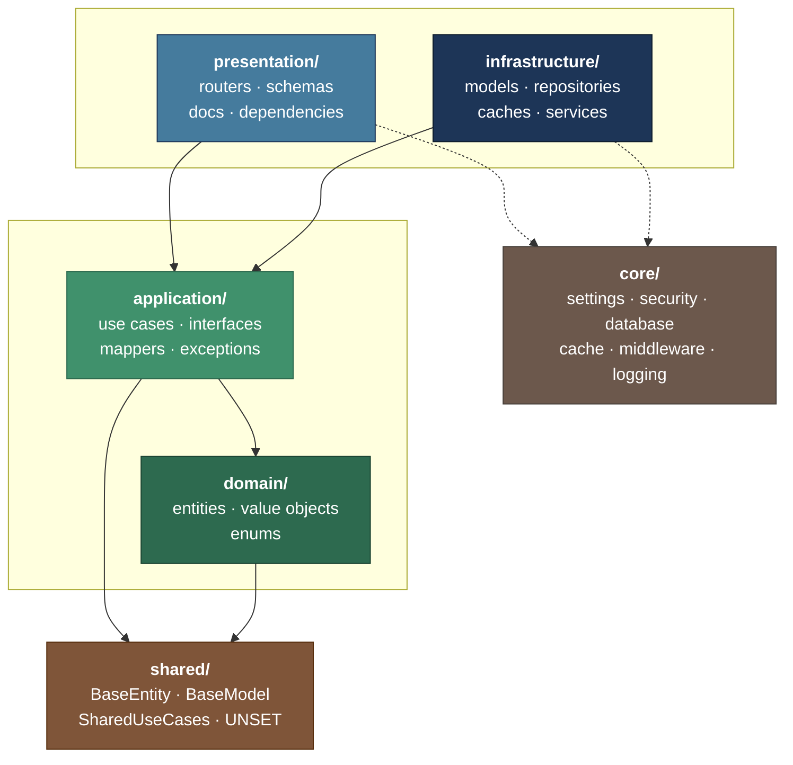
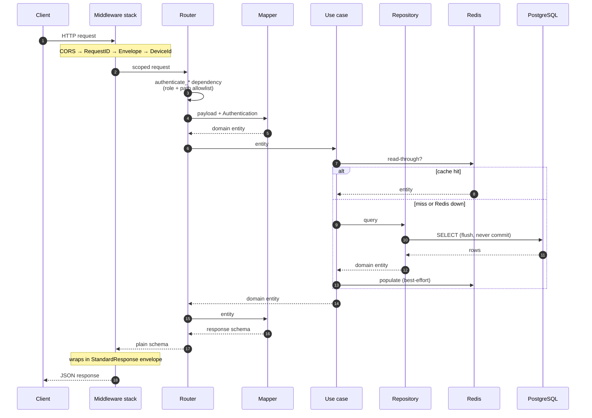

# پایهٔ پروژه — FastAPI + Clean Architecture + DDD

[English](README.md) · **فارسی**

یک **بیس آمادهٔ تولید** برای شروع سریع پروژه‌های بک‌اند با FastAPI. معماری تمیز،
Domain-Driven Design و همه‌چیز از قبل سیم‌کشی‌شده — به‌جای پوشه‌های خالی و یک
دیاگرام، یک اپلیکیشن کارکننده تحویل می‌گیری و فقط کد دامنهٔ خودت را اضافه می‌کنی.

هدف این مخزن **پایه بودن** است: کلون کن، نامش را عوض کن، سه کامند بزن، شروع کن
به کدنویسی.

---

## فهرست

- [شروع سریع](#شروع-سریع)
- [گردش کار از صفر](#گردش-کار-از-صفر)
- [مرجع کامل کامندها](#مرجع-کامل-کامندها)
- [اسکریپت‌ها](#اسکریپتها)
- [ابزارهای opencode (اسکیل‌ها و ایجنت‌ها)](#ابزارهای-opencode-اسکیلها-و-ایجنتها)
- [معماری](#معماری)
- [ساختار یک ماژول](#ساختار-یک-ماژول)
- [الگوهای خطا](#الگوهای-خطا)
- [تست](#تست)
- [پیکربندی (.env)](#پیکربندی-env)
- [پایگاه داده و مهاجرت](#پایگاه-داده-و-مهاجرت)
- [امنیت](#امنیت)
- [عیب‌یابی](#عیبیابی)
- [راهنمای کاربر](docs/user-guide.md)
- [ارتقاها](#ارتقاها)
- [تقدیر](#تقدیر)
- [مشارکت](#مشارکت)
- [مجوز](#مجوز)

---

## شروع سریع

### پیش‌نیازها

| ابزار | نسخه | چرا |
|---|---|---|
| [Python](https://www.python.org/) | 3.14+ | در `.python-version` پین شده |
| [uv](https://docs.astral.sh/uv/) | آخرین | مدیریت وابستگی و virtualenv |
| PostgreSQL | 17 (یا Docker) | منبع حقیقت داده |
| Redis | 8 (یا Docker) | کش و نشست‌ها |

> Docker **اجباری نیست**. اگر PostgreSQL و Redis را به‌صورت native روی سیستم داری،
> همان کافی است. کامندهای Docker فقط یک مسیر جایگزین برای بالا آوردن وابستگی‌هاست.

### یک کامند

```bash
uv sync          # نصب وابستگی‌ها
make install     # ویزارد: چند سؤال، بعد همه‌چیز خودکار
make dev         # بالا آوردن سرور
```

`make install` یک نصب‌کنندهٔ یکپارچه است که با چند پرسش، همه‌چیز را آماده می‌کند:

| گام | کار |
|---|---|
| ۱ | **opencode** — اعتبارسنجی/ساخت `opencode.jsonc` و اسکیل‌ها و کامندهای `.opencode/` |
| ۲ | **`.env`** — نوشتن کامل هر ۸۳ کلید، با secretهای تولیدشده و مقادیر مشتق از نام پروژه |
| ۳ | **توکن‌ها** — تولید جفت‌کلیدهای JWT (Ed25519 + X25519) در `secrets/keys/` |
| ۴ | **دیتابیس** — ساخت role + database، اجرای مهاجرت اولیه، ساخت کاربر ادمین |
| ۵ | **جمع‌بندی** — چاپ اطلاعات ورود و گام‌های بعدی |

سؤال‌ها فقط چیزهایی هستند که ماشین نمی‌تواند حدس بزند و بقیه با Enter قبول
می‌شوند:

```text
Project name        [my-project]
Database name       [my-project]
Database user       [my]
Database password   [auto-generate]
Database host       [localhost]
Admin name          [Admin User]
Admin email         [admin@example.com]
Admin password      [auto-generate]
Install opencode skills globally too [y/N]
```

برای حالت بدون سؤال (CI یا اسکریپت):

```bash
make install-yes p="Acme CRM"
# یا کنترل کامل:
uv run python scripts/install.py --yes \
  --project "Acme CRM" --db-name acme_crm --db-user acme \
  --db-password "..." --admin-email admin@acme.io --admin-password "..."
```

> اگر `sudo` برای ساخت role رمز بخواهد و ترمینال تعاملی نباشد، اسکریپت متوقف
> نمی‌شود؛ دستورهای آمادهٔ کپی را چاپ می‌کند و بقیهٔ گام‌ها را ادامه می‌دهد.

بعد از این کامندها:

| سرویس | آدرس |
|---|---|
| API | http://localhost:8000 |
| Swagger UI | http://localhost:8000/docs |
| ReDoc | http://localhost:8000/redoc |
| Health check | http://localhost:8000/health/ |

ورود ادمین همان ایمیل/پسوردی است که در ویزارد تعیین کردی (در جمع‌بندی چاپ می‌شود).

### اولین درخواست

ورود **form-encoded** است، نه JSON:

```bash
curl -X POST http://localhost:8000/api/v1/authentication/login/ \
  -H "Content-Type: application/x-www-form-urlencoded" \
  -d "username=$SECURITY_ADMIN_EMAIL&password=$SECURITY_ADMIN_PASSWORD" \
  -c cookies.txt

curl http://localhost:8000/api/v1/user/me/ -b cookies.txt
```

### نصب CLI با pip

همان اسکریپت‌ها به‌صورت یک توزیع آمادهٔ PyPI هم بسته‌بندی شده‌اند، پس `fastddd` را
می‌توان با `pip` (یا `uv`) نصب کرد و دیگر لازم نیست `uv run` بزنی:

```bash
pip install .            # در یک virtualenv تازه، از روی همین ریپوی کلون‌شده
pip install -e .         # نصب ویرایشی، برای توسعهٔ خودِ CLI
uv tool install .        # نصب سراسری و ایزولهٔ دستور `fastddd`
```

نیازمند **Python 3.14+** است. بعد از نصب، `fastddd <command>` از هر دایرکتوری کار
می‌کند (مثلاً `fastddd setup`، `fastddd doctor`، `fastddd new-module billing`) — فهرست
کامل دستورها در [راهنمای کاربر](docs/user-guide.md#۶-cli-یکپارچهٔ-fastddd). بعد از
انتشار روی PyPI همین نصب از مخزن هم کار می‌کند: `pip install clean-architecture`.

---

## گردش کار از صفر

برای شروع هر پروژهٔ جدید روی این بیس:

```bash
# ۱. کلون
git clone https://github.com/Elmino-19/clean-architecture.git my-project && cd my-project

# ۲. نام‌گذاری مجدد (اختیاری ولی توصیه‌شده)
make rebrand name="Acme CRM" author="نام شما" email="you@acme.io"

# ۳. نصب وابستگی‌ها
uv sync

# ۴. نصب و راه‌اندازی کامل (ویزارد)
make install

# ۵. اجرا
make dev
```

اگر می‌خواهی هر گام را جدا کنترل کنی:

```bash
make setup       # فقط .env
make provision   # فقط دیتابیس + مهاجرت + ادمین
make opencode    # فقط کانفیگ opencode (نصب سراسری اسکیل‌ها)
```

### هر بار بعد از تغییرات

```bash
make test        # اجرای تست‌ها
make lint        # بررسی کیفیت کد
make format      # فرمت خودکار
```

---

## مرجع کامل کامندها

### راه‌اندازی اولیه

| کامند | توضیح |
|---|---|
| `make install` | **نصب‌کنندهٔ یکپارچه.** ویزارد چندسؤالی، سپس opencode + `.env` + توکن‌ها + دیتابیس + مهاجرت + ادمین. |
| `make install-yes p="نام پروژه"` | همان `install` بدون هیچ سؤال. مناسب CI یا اسکریپت. `p` نام پروژه است. |
| `make opencode` | فقط کانفیگ opencode: اعتبارسنجی `opencode.jsonc` و نصب سراسری اسکیل/کامندها در `~/.config/opencode/`. |
| `make setup` | فقط `.env` را می‌سازد (بدون دیتابیس). |
| `make setup-yes p="نام پروژه"` | همان `setup` بدون سؤال. |
| `make env-check` | فقط بررسی می‌کند `.env` کامل و معتبر است یا نه. کد خروجی ۱ اگر کلیدی خالی باشد. |
| `make provision` | role و database در PostgreSQL، مهاجرت‌ها، کاربر ادمین و بررسی Redis. همه idempotent. |
| `make provision-check` | فقط گزارش می‌دهد چه چیزی وجود دارد و چه چیزی کم است؛ چیزی نمی‌سازد. |
| `make bootstrap` | `setup` + `provision` پشت سر هم (همان `install` منهای گام opencode). |
| `make rebrand name="..." author="..." email="..."` | نام template را به پروژهٔ تو تغییر می‌دهد. |
| `make doctor` | گزارش کامل وضعیت: env، دسترسی سرویس‌ها، کلیدهای JWT، دیتابیس، ادمین. فقط-خواندن. |

> **نکته:** ساخت role/database روی لینوکس به `sudo -u postgres` نیاز دارد. اگر sudo
> رمز بخواهد و ترمینال تعاملی نباشد، اسکریپت دستورهای آمادهٔ کپی را چاپ می‌کند و
> ادامه می‌دهد؛ اجرا کن و دوباره `make provision` بزن.

### اجرا و توقف

| کامند | توضیح |
|---|---|
| `make dev` | اجرای محلی با `uvicorn --reload` روی پورت `APPLICATION_PORT`. |
| `make start` | بالا آوردن کل استک با Docker Compose و دنبال کردن لاگ. |
| `make start-silent` | همان، بدون دنبال کردن لاگ (detached). |
| `make stop` | توقف استک Docker. |
| `make delete` | توقف و **حذف volumeها** — داده‌ها پاک می‌شوند. |

### وابستگی‌ها (Docker، اختیاری)

| کامند | توضیح |
|---|---|
| `make dependencies-up` | فقط PostgreSQL، pgAdmin، Redis و RedisInsight + لاگ. |
| `make dependencies-up-silent` | همان، detached. |
| `make dependencies-down` | توقف وابستگی‌ها. |
| `make logs` | دنبال کردن لاگ Compose. |
| `make view-processes` | `docker ps -a`. |

### کیفیت کد

| کامند | توضیح |
|---|---|
| `make test` | اجرای کل تست‌ها با pytest. |
| `make test-watch` | اجرای تست‌ها و تکرار خودکار با تغییر فایل‌ها. |
| `make lint` | بررسی با Ruff. |
| `make format` | فرمت خودکار با Ruff. |
| `make build` | ساخت wheel و sdist در `dist/`. |
| `make publish` | `uv build` سپس `uv publish` (توکن PyPI یا trusted publishing). |

### انتشار روی PyPI

`version` را در `pyproject.toml` بالا ببر، سپس یا یک تگ بزن (`git tag v3.0.0 &&
git push origin v3.0.0`) — فایل `.github/workflows/publish.yml` بسته را می‌سازد و پس از
بررسی هم‌خوانی تگ با نسخه، با
[trusted publishing](https://docs.pypi.org/trusted-publishers/) روی PyPI آپلود می‌کند —
یا دستی با `make publish` منتشر کن.

### دیتابیس

| کامند | توضیح |
|---|---|
| `make migrate` | اعمال مهاجرت‌ها تا head. |
| `make migration m="create_x"` | ساخت مهاجرت جدید با autogenerate. |

### عمومی

| کامند | توضیح |
|---|---|
| `make help` | فهرست همهٔ هدف‌ها. |

---

## اسکریپت‌ها

همهٔ اسکریپت‌ها زیر `scripts/` هستند و هم به‌صورت `make` و هم مستقیم با
`uv run python scripts/<name>.py` قابل اجرا.

### `install.py` — نصب‌کنندهٔ یکپارچه

قلب کار: یک ویزارد با چند سؤال که همهٔ گام‌ها را پشت سر هم انجام می‌دهد. این
اسکریپت از `opencode_setup`، `setup_env` و `provision` استفاده می‌کند و آن‌ها را
همه با یک جریان راهبری می‌کند. جزئیات جریان در بخش
[شروع سریع](#یک-کامند) آمده است.

```bash
uv run python scripts/install.py                    # ویزارد تعاملی
uv run python scripts/install.py --yes --project "Acme CRM"
uv run python scripts/install.py --skip-database    # فقط .env و توکن‌ها
uv run python scripts/install.py --global-assets    # نصب سراسری اسکیل‌ها
```

| آرگومان | کار |
|---|---|
| `--project` | نام پروژه |
| `--db-name` / `--db-user` / `--db-password` / `--db-host` / `--db-port` | مشخصات دیتابیس |
| `--admin-name` / `--admin-email` / `--admin-password` | حساب ادمین |
| `--environment` | `development` \| `homolog` \| `production` |
| `--yes` | بدون سؤال، همه پیش‌فرض‌ها |
| `--global-assets` | کپی اسکیل/کامندها در `~/.config/opencode/` |
| `--force` | چرخاندن secretها |
| `--skip-opencode` / `--skip-database` | رد کردن گام‌های انتخابی |

### `opencode_setup.py` — کانفیگ opencode

`opencode.jsonc` را اعتبارسنجی می‌کند (و اگر خراب باشد با نگه‌داشتن backup
بازسازی می‌کند) و در صورت درخواست، اسکیل‌ها و کامندهای پروژه را در
`~/.config/opencode/` نصب می‌کند.

```bash
uv run python scripts/opencode_setup.py            # فقط بررسی پروژه
uv run python scripts/opencode_setup.py --global   # + نصب سراسری
```

> دارایی‌های opencode در پوشهٔ `.opencode/` پروژه هستند و چون opencode پوشهٔ
> `.opencode/` را خودکار می‌خواند، به‌صورت پروژه‌محور هم بدون نصب کار می‌کنند.

### `setup_env.py` — ساخت خودکار `.env`

مسئله: `.env.example` حدود ۸۳ کلید دارد که بیشترشان خالی‌اند و پر کردن دستی‌شان
وقت‌گیر و خطاپذیر است. این اسکریپت آن‌ها را در سه لایه پر می‌کند:

| لایه | مثال | رفتار |
|---|---|---|
| **تولیدی** | `REDIS_PASSWORD`, `JWT_HASH_FINGERPRINT`, `SECURITY_ADMIN_PASSWORD` | مقدار تصادفی امن تولید می‌شود |
| **مشتق‌شده** | `APPLICATION_TABLE_PREFIX`, `POSTGRESQL_DATABASE`, `REDIS_KEY_PREFIX`, `LOGS_NAME` | از نام پروژه (slug) ساخته می‌شود |
| **حفظ‌شده** | هر کلیدی که قبلاً مقدار دارد | دست‌نخورده می‌ماند |

ویژگی‌های مهم:

- **Idempotent:** اجرای دوباره پسورد زندهٔ دیتابیس را نمی‌چرخاند.
- **تشخیص پورت آزاد:** اگر ۸۰۰۰/۵۴۳۲/۶۳۷۹ اشغال باشد، پورت آزاد بعدی را خودکار
  انتخاب می‌کند و `APPLICATION_URL`/`JWT_ISSUER` را با آن هم‌گام می‌کند.
- **`--force`:** چرخاندن اجباری secretها.

```bash
# تعاملی
uv run python scripts/setup_env.py

# بدون سؤال
uv run python scripts/setup_env.py --yes --project "Acme CRM" --admin-email a@b.io

# فقط بررسی
uv run python scripts/setup_env.py --check
```

| آرگومان | کار |
|---|---|
| `--project` | نام پروژه (slug) |
| `--title` | بازنویسی `APPLICATION_TITLE` |
| `--host` | هاست برای ساخت URLها (پیش‌فرض `localhost`) |
| `--environment` | `development` \| `homolog` \| `production` |
| `--cookie-samesite` | `lax` \| `strict` \| `none` |
| `--admin-email` | ایمیل ادمین (بدون پرسیدن) |
| `--admin-password` | پسورد ادمین (بدون پرسیدن) |
| `--contact-phone` | تلفن تماس OpenAPI |
| `--yes` | بدون هیچ پرسشی |
| `--force` | چرخاندن secretها حتی اگر مقدار دارند |
| `--check` | فقط گزارش کمبودها |

### `provision.py` — ساخت دیتابیس، ادمین و توکن‌ها

به ترتیب وابستگی اجرا می‌کند و هر گام idempotent است:

```
role + database  →  migrations  →  admin user
redis check
```

- **PostgreSQL:** اگر role یا database نباشد، با `sudo -u postgres psql` می‌سازد.
  روی لینوکس این مسیر معمولاً لازم است چون `pg_hba.conf` برای superuser احراز
  `peer` می‌گذارد و ورود با پسورد روی TCP را رد می‌کند. اگر sudo رمز بخواهد و
  ترمینال تعاملی نباشد، دستورهای آماده چاپ می‌شوند.
- **Redis:** اتصال با پسورد `.env` را بررسی می‌کند (never-fail؛ فقط هشدار).
- **Migrations:** `alembic upgrade head`.
- **Admin:** کاربر با نقش `ADMIN` و پسورد هش‌شدهٔ Argon2 می‌سازد.

```bash
uv run python scripts/provision.py                 # همه‌چیز
uv run python scripts/provision.py --check         # فقط وضعیت
uv run python scripts/provision.py --skip-redis    # رد کردن Redis
uv run python scripts/provision.py --skip-migrations
uv run python scripts/provision.py --skip-admin
uv run python scripts/provision.py --admin-name "Sara Ahmadi"
```

### `doctor.py` — بررسی سلامت (فقط-خواندن)

هیچ‌چیز نمی‌سازد و هیچ‌چیز را تغییر نمی‌دهد. بررسی می‌کند:

- `.env` کامل و معتبر باشد
- PostgreSQL و Redis در دسترس باشند
- کلیدهای JWT وجود داشته باشند
- role/database ساخته شده باشند
- کاربر ادمین seed شده باشد

```bash
make doctor
# یا
uv run python scripts/doctor.py
```

کد خروجی ۱ اگر هر بررسی شکست بخورد — مناسب CI.

### `rebrand.py` — تغییر نام template

نام template در چهار شکل hardcode شده: slug خط‌تیره (Docker)، slug زیرخط (نام
جدول‌ها)، نام نمایشی Title Case و اطلاعات تماس نویسنده. این اسکریپت هر چهار شکل
را به‌همراه نام پکیج در `pyproject.toml` جایگزین می‌کند.

```bash
# نمایش تغییرات بدون نوشتن
uv run python scripts/rebrand.py "Acme CRM" --dry-run

# اعمال
uv run python scripts/rebrand.py "Acme CRM" \
  --author "نام شما" --email "you@acme.io" --url "https://acme.io"

# نوشتن مستندات هم (README و docs) با --docs
uv run python scripts/rebrand.py "Acme CRM" --docs
```

| آرگومان | کار |
|---|---|
| `--author` / `--email` / `--url` | اطلاعات تماس |
| `--docs` | بازنویسی README و markdownها هم |
| `--dry-run` | فقط نمایش، بدون نوشتن |

> به‌طور پیش‌فرض `README.md` دست‌نخورده می‌ماند چون حاوی توضیحات معماری است که
> می‌خواهی نگه داری. با `--docs` آن‌ها را هم بازنویسی کن.

### `create_module.py` — ساخت اسکلت ماژول

```bash
uv run python scripts/create_module.py
```

نام ماژول را می‌پرسد و ساختار کامل چهارلایه را می‌سازد (فایل‌های لازم + پوشهٔ
تست).

### سایر اسکریپت‌ها

| اسکریپت | کار |
|---|---|
| `generate_secret.py` | یک secret هگز ۳۲ بایتی چاپ می‌کند |
| `generate_fernet.py` | یک کلید Fernet چاپ می‌کند |
| `directory_tree.py` | درخت پروژه را در `scripts/directory_tree.txt` می‌نویسد |
| `websocket_test.html` | کلاینت WebSocket مرورگری (در `development` روی `/devtools/`) |
| `asyncapi.yaml` | مشخصات AsyncAPI برای کانال WebSocket |

---

## ابزارهای opencode (اسکیل‌ها و ایجنت‌ها)

پروژه یک بسته‌ی اسکیل و ایجنت همراه دارد که در `.opencode/` قرار می‌گیرند و
opencode خودکار می‌خواند. برای نصب سراسری در همهٔ پروژه‌ها:

```bash
make opencode      # کپی در ~/.config/opencode/
```

### اسکیل‌ها

| اسکیل | کار |
|---|---|
| `software-design-document` | نوشتن سند جامع طراحی نرم‌افزار (قالب، قواعد معماری، قراردادها) |
| `backend-development` | پیاده‌سازی کد مطابق معماری: دستور هر لایه، الگوهای خطا، تراکنش، نام‌گذاری |

هر اسکیل یک `SKILL.md` کوتاه است و جزئیات در `references/` کنارش می‌آید
(progressive disclosure).

### ایجنت‌ها

| ایجنت | نقش | دسترسی |
|---|---|---|
| `sdd-writer` | نوشتن سند جامع طراحی (`docs/sdd.md`)، بدون کد | ویرایش آزاد |
| `code-explorer` | آنالیز و کاوش کدبیس: معماری، جریان، blast radius | فقط-خواندن |
| `backend-developer` | پیاده‌سازی کد بک‌اند (ماژول، use case، repository، router) | ویرایش آزاد |
| `code-auditor` | بازبینی کد و تطبیق با قوانین/اسکیل‌ها؛ گزارش انحراف | فقط-خواندن |

### کامندها

هر کامند یکی از ایجنت‌ها را در یک **دامنهٔ مشخص** صدا می‌زند. متن بعد از نام کامند
به‌عنوان آرگومان به ایجنت می‌رسد (اگر خالی بماند، خودش می‌پرسد).

| خانواده | ایجنت | فایل | ماژول | لایه (همهٔ ماژول‌ها) | همهٔ ماژول‌ها |
|---|---|---|---|---|---|
| `audit-*` | code-auditor | `/audit-file <path>` | `/audit-module <module>` | `/audit-layer <layer>` | `/audit-all` |
| `explore-*` | code-explorer | `/explore-file <path>` | `/explore-module <module>` | `/explore-layer <layer>` | `/explore-all` |
| `develop-*` | backend-developer | `/develop-file <path>` | `/develop-module <module>` | `/develop-layer <layer>` | `/develop-all` |
| `design-*` | sdd-writer | `/design-file <part>` | `/design-module <module>` | `/design-layer <concern>` | `/design-all` |

- `<layer>` یکی از `domain` \| `application` \| `infrastructure` \| `presentation`.
- کامندهای `audit-*` و `explore-*` به‌صورت **subtask** اجرا می‌شوند: در یک نشست
  جدا انجام و نتیجه خلاصه برمی‌گردد، تا کانتکست اصلی شلوغ نشود.
- کامندهای `develop-*` و `design-*` در همان نشست اجرا می‌شوند تا تعاملی بمانند.

پس از تغییر این بسته، opencode را **quit و restart** کن تا لود شود.

---

## معماری

هر ماژول به چهار لایه تقسیم می‌شود. وابستگی‌ها **فقط به سمت داخل** است — دامنه
هیچ‌چیز بیرونی را نمی‌شناسد.



| لایه | پوشه | محتوا | مجاز به import |
|---|---|---|---|
| **Domain** | `domain/` | `entities.py`, `value_objects.py`, `enums.py` | فقط `shared`. **بدون** FastAPI، SQLAlchemy، Pydantic |
| **Application** | `application/` | `use_cases.py`, `interfaces.py`, `mappers.py`, `exceptions.py`, `utils.py` | `domain`, `shared` |
| **Infrastructure** | `infrastructure/` | `models.py`, `repositories.py`, `caches.py`, `services.py` | `domain`, `application`, `core` |
| **Presentation** | `presentation/` | `routers.py`, `schemas.py`, `docs.py`, `dependencies.py` | همه‌چیز زیر خودش |

لایهٔ application به قراردادهای `typing.Protocol` وابسته است، هرگز به کلاس‌های
عینی. همین است که یک use case را با fake درون‌حافظه‌ای تست‌پذیر می‌کند و اجازه
می‌دهد PostgreSQL را بدون لمس منطق کسب‌وکار عوض کنی.

### چرخهٔ عمر یک درخواست



هندلرها هرگز پوشش پاسخ را نمی‌سازند — `ResponseFormattingMiddleware` این کار را
می‌کند. هندلرها هرگز منطق کسب‌وکار ندارند — use case این کار را می‌کند. بدنهٔ هر
هندلر دقیقاً `payload → mapper → use case → mapper → return` است.

### ماژول‌ها

```text
app/modules/
├── shared/           انواع پایه — route ندارد
├── authentication/   ورود، refresh، خروج؛ صدور JWT تودرتو
├── user/             حساب‌ها و نقش‌ها
├── key/              کلیدهای API — کامل‌ترین ماژول (مرجع)
├── knowledge/        CRUD + اعلان broadcast (مرجع)
├── notification/     per-user و fan-out بر اساس نقش
├── websocket/        تحویل بلادرنگ
├── health/           liveness و نسخهٔ Alembic
└── example/          ماژول مرجع حداقلی، بدون persistence
```

> وقتی الگویی مبهم است، **`key`** را بخوان. تنها ماژولی است که هر لایه را تمرین
> می‌کند: کش با tombstone، سرویس، CRUD کامل، و مدیریت secret گذرا.

---

## ساختار یک ماژول

```text
app/modules/{module}/
├── domain/
│   ├── entities.py          dataclassهایی که از BaseEntity ارث می‌برند؛ اعتبارسنجی در __post_init__
│   ├── value_objects.py     کلاس‌های ساده: _normalize → _validate → __str__ → __eq__
│   └── enums.py             enumهای ماژول، همیشه (str, Enum)
├── application/
│   ├── interfaces.py        قراردادهای Protocol: I{Entity}Repository / Cache / Service
│   ├── use_cases.py         یک کلاس {Module}UseCases؛ قوانین کسب‌وکار اینجا
│   ├── mappers.py           ENTITY/DTOS · ENTITY/MODELS · ENTITY/CACHE
│   ├── exceptions.py        {Module}Exception عمومی + یکی per قاعدهٔ کسب‌وکار
│   └── utils.py             کمک‌کننده‌های محلی ماژول
├── infrastructure/
│   ├── models.py            مدل‌های SQLAlchemy که از BaseModel ارث می‌برند
│   ├── repositories.py      Postgres{Entity}Repository — flush()، هرگز commit()
│   ├── caches.py            Redis{Entity}Cache — نام‌فضادار، tombstone، never-raise
│   └── services.py          سیستم‌های بیرونی یا stateful پشت Protocol
└── presentation/
    ├── routers.py           هندلرها: payload → mapper → use case → mapper → return
    ├── schemas.py           Pydantic v2 با Field و ConfigDict کامل
    ├── docs.py              router_docs + یک {action}_docs per endpoint
    └── dependencies.py      کارخانه‌های Depends، با برگرداندن نوع Protocol
```

فایل‌های خالی طبیعی‌اند. یک ماژول اسکلت کامل را نگه می‌دارد حتی وقتی یک فایل
استفاده نمی‌شود — یک `caches.py` خالی یعنی «این ماژول کش ندارد»، نه «کسی فایل را
فراموش کرده».

`scripts/create_module.py` دقیقاً همین درخت را می‌سازد.

### قواعد نام‌گذاری

| مفهوم | الگو | مثال |
|---|---|---|
| ماژول | snake_case مفرد | `knowledge` |
| Entity | PascalCase بدون پسوند | `Knowledge` |
| Enum | PascalCase + Status/Type/Role | `Role` |
| Domain Error | PascalCase + Error | `KnowledgeNotFoundError` |
| Interface | `I` + PascalCase + Repository/Service | `IKnowledgeRepository` |
| Use Case | `{Module}UseCases` | `KnowledgeUseCases` |
| Model | PascalCase + Model | `KnowledgeModel` |
| Repository | `Postgres` + PascalCase + Repository | `PostgresKnowledgeRepository` |
| Cache | `Redis` + PascalCase + Cache | `RedisKnowledgeCache` |
| Router | متغیر `router` | `router = APIRouter(**router_docs)` |
| Table | `{prefix}_{plural_snake}` | `acme_crm_knowledges` |
| Constraint | `uq_/ix_/ck_/fk_` + نام جدول | `uq_knowledges_name` |

---

## الگوهای خطا

سه شکل، یکی per نوع لایه. اشتباه در این مورد پرهزینه‌ترین خطای کدبیس است.

**3-branch** — use caseها و هندلرهای router:

```python
except StandardException:
    raise
except DomainError as e:
    raise DomainException(e)
except Exception as e:
    logger.opt(exception=e).error("An error occurred in the create endpoint.")
    raise KnowledgeException()
```

**2-branch** — repositoryها و serviceها. شاخهٔ `DomainError` ندارند: این لایه‌ها
هرگز قوانین دامنه را ارزیابی نمی‌کنند.

```python
except StandardException:
    raise
except Exception as e:
    logger.opt(exception=e).error("An error occurred in the create repository.")
    raise KnowledgeException()
```

**Never-raise** — cacheها. هر متد catch می‌کند، log می‌کند و `None` برمی‌گرداند.

```python
except Exception as e:
    logger.opt(exception=e).error(
        "An error occurred in the get cache. Falling back to the database."
    )
    return None
```

> [!WARNING]
> `except StandardException` **باید اول بیاید**. `StandardException` از
> `HTTPException` ارث می‌برد، پس هر ترتیب دیگری هر ۴۰۴ و ۴۰۹ عمدی را در ۵۰۰
> می‌بلعد.

یک خطای cache به دیتابیس تنزل می‌کند و هرگز نباید درخواست را fail کند — به همین
دلیل شکل cache هیچ شاخهٔ re-raise ندارد.

---

## تست

سیاست **unit-first** است: use caseها را با fake درون‌حافظه‌ای از Protocolهایشان
می‌رانیم، entityها را مستقیم می‌سازیم و به هیچ دیتابیس، Redis یا شبکه دست
نمی‌زنیم.

```bash
make test          # اجرای کل تست‌ها
make test-watch    # اجرای مجدد خودکار با تغییر فایل‌ها
```

ساختار:

```text
test/
├── fakes.py                         fakeهای درون‌حافظه‌ای برای همهٔ Portها
├── core/
└── modules/
    └── knowledge/
        ├── test_domain.py           تست لایهٔ دامنه (خالص)
        └── test_use_cases.py        تست use case با fake
```

### نوشتن تست برای ماژول جدید

1. اگر ماژولت Port جدید دارد، fake آن را در `test/fakes.py` اضافه کن.
2. تست دامنه: entity/value object را مستقیم بساز و قواعد را بسنج.
3. تست use case: fake را تزریق کن و رفتار و قوانین کسب‌وکار را بسنج.

```python
# نمونهٔ تست use case با fake
async def test_rejects_duplicate_name(use_cases, manager):
    await use_cases.create(Knowledge(name="Duplicate", created_by=manager))
    with pytest.raises(KnowledgeNameAlreadyExistsException):
        await use_cases.create(Knowledge(name="Duplicate", created_by=manager))
```

`pytest` و `pytest-asyncio` از قبل پیکربندی شده‌اند (`asyncio_mode = "auto"`).

---

## پیکربندی (.env)

هر تنظیم یک فیلد تایپ‌دار روی `Settings` در `app/core/settings.py` است که با
pydantic-settings از `.env` خوانده می‌شود. همیشه از singleton `settings` استفاده
کن — هرگز `os.environ`.

> [!IMPORTANT]
> بیشتر فیلدها **اجباری**اند. یک مقدار خالی `ValidationError` می‌دهد که نام کلید
> را در استارت چاپ می‌کند. این عمدی است: یک default خاموش که بین محیط‌ها فرق کند
> خیلی سخت‌تر از یک شکست در استارت دیباگ می‌شود.

### گروه‌های کلیدها

| گروه | تعداد | نمونه |
|---|---|---|
| APPLICATION | ۱۳ | `APPLICATION_TITLE`, `APPLICATION_PORT`, `APPLICATION_TABLE_PREFIX` |
| API KEY | ۳ | `API_KEY_PREFIX`, `API_KEY_HASH_FINGERPRINT` |
| AUTH | ۵ | نام و توضیح schemeها |
| COOKIES | ۹ | `COOKIES_ACCESS_TOKEN_KEY`, `COOKIES_SAME_SITE` |
| JWT | ۱۳ | `JWT_ISSUER`, `JWT_ACCESS_TOKEN_EXPIRE_MINUTES`, مسیر کلیدها |
| LOGS | ۵ | `LOGS_LEVEL`, `LOGS_NAME` |
| POSTGRESQL | ۵ | `POSTGRESQL_DATABASE`, `POSTGRESQL_HOST` |
| PGADMIN | ۳ | اطلاعات ورود pgAdmin (فقط Compose) |
| REDIS | ۱۸ | `REDIS_PASSWORD`, `REDIS_DEFAULT_TTL_SECONDS` |
| REDISINSIGHT | ۲ | فقط Compose |
| NGROK | ۱ | توکن اختیاری تونل در `development` |
| SECURITY | ۶ | `SECURITY_ALLOW_ORIGINS`, `SECURITY_ADMIN_EMAIL` |

### مقادیر مشتق‌شده (computed)

این‌ها از کلیدهای بالا محاسبه می‌شوند و نباید مستقیم ست شوند:

| ویژگی | مشتق از |
|---|---|
| `POSTGRESQL_DATABASE_URL` / `_ASYNC_DATABASE_URL` | گروه `POSTGRESQL_*` |
| `REDIS_URL` | گروه `REDIS_*` |
| `REDIS_NAMESPACE` | `REDIS_KEY_PREFIX` + `REDIS_CACHE_VERSION` |
| `JWT_SIGNING_*_KEY`, `JWT_ENCRYPTION_*_KEY` | فایل‌های PEM روی دیسک |
| `SECURITY_*_ALLOWED_PATHS` | قواعد مسیر per-tier |
| `COOKIES_ACCESS_TOKEN_MAX_AGE` | `JWT_ACCESS_TOKEN_EXPIRE_MINUTES × 60` |

> انقضای JWT را ست کن، نه عمر کوکی را — عمر کوکی تبعیت می‌کند.

### محیط‌ها

`APPLICATION_ENVIRONMENT`: یکی از `development` | `homolog` | `production`.

- در `development`: مستندات (`/docs`, `/redoc`) فعال، ابزارهای توسعه روی
  `/devtools/` mount می‌شوند و ngrok اجرا می‌شود.
- در `production`: مستندات خاموش و ngrok غیرفعال.

---

## پایگاه داده و مهاجرت

### جدول‌ها

جدول‌ها پیشوند `APPLICATION_TABLE_PREFIX` دارند، پس با پیش‌فرض `acme_crm` جدول
کاربران می‌شود `acme_crm_users`. مهاجرت‌ها هم از همین تنظیم می‌خوانند، پس نام
جدول‌ها بین مدل‌ها، مهاجرت‌ها و دیتابیس همیشه یکسان است.

### قراردادها

| مفهوم | قاعده | مثال |
|---|---|---|
| نام جدول | `{prefix}_{plural_snake}` | `acme_crm_keys` |
| نوع Enum | `{snake}_enum` | `role_enum` |
| Unique | `uq_{plural}_{cols}` | `uq_keys_hashed_key` |
| Index | `ix_{plural}_{cols}` | `ix_keys_prefix` |
| Check | `ck_{plural}_{rule}` | `ck_keys_single_owner` |
| Soft delete | `is_active = false` | هرگز `DELETE` فیزیکی |

### مهاجرت‌ها

```bash
make migrate                          # اعمال تا head
make migration m="create_my_entity"   # ساخت مهاجرت جدید
```

> [!IMPORTANT]
> یک مدل جدید باید در `migrations/env.py` import و به لیست `_ = [...]` اضافه شود.
> autogenerate فقط مدل‌های ثبت‌شده را می‌بیند — و بدتر، برای جدول زنده‌ای که مدلش
> را نمی‌بیند `drop_table` صادر می‌کند.

برنامه در استارت `alembic upgrade head` را اجرا می‌کند، پس یک استک تازه خودش را
مهاجرت می‌دهد.

---

## امنیت

### ورود و نشست

- JWT تودرتو: امضای **JWS** با Ed25519، بسته‌بندی‌شده در **JWE** با
  ECDH-ES + A256GCM.
- توکن‌ها در کوکی‌های **HTTP-only** می‌آیند، نه هدر `Authorization`.
- اثر انگشت HMAC-SHA256 از `jti` هر توکن در دیتابیس ذخیره می‌شود (نه خود توکن)،
  که توکن‌ها را revocable می‌کند.
- هش پسورد با **Argon2id**.

### نقش‌ها و دو دروازه

| Tier | تنظیم | دسترسی |
|---|---|---|
| Public | `SECURITY_NO_AUTH_PATHS` | همه، حتی ناشناس |
| User | `SECURITY_USER_ALLOWED_PATHS` | Public + user |
| Manager | `SECURITY_MANAGER_ALLOWED_PATHS` | User + manager |
| Admin | `SECURITY_ADMIN_ALLOWED_PATHS` | Manager + admin |
| API key | `SECURITY_API_KEY_ALLOWED_PATHS` | مستقل — فعلاً خالی |

هر مسیر **یک بار** در پایین‌ترین tierی که باید به آن برسد تعریف می‌شود. هر دو
شکل با و بدون اسلش پایانی لازم است:

```python
(_path_rule("/api/v1/key/", "POST"),)
(_path_rule("/api/v1/key", "POST"),)
```

> [!WARNING]
> فراموش کردن شکل دوم شایع‌ترین علت «در Swagger کار می‌کند، از کلاینت ۴۰۳ می‌دهد» است.

### کلیدهای API

چرخهٔ کامل: create، list، rotate، revoke. کلید خام **فقط یک بار** برگردانده
می‌شود و هرگز ذخیره نمی‌شود؛ فقط `hashed_key`، `prefix` و `last_four` می‌مانند.

---

## عیب‌یابی

### `make env-check` می‌گوید کلیدی خالی است

```bash
make setup        # پر کردن خودکار
```

### `make provision` می‌گوید `sudo needs a password`

روی لینوکس ساخت role/database نیاز به superuser دارد. دستورهای چاپ‌شده را در یک
ترمینال تعاملی اجرا کن، سپس:

```bash
make provision
```

اگر Docker داری و ترجیح می‌دهی از آن استفاده کنی:

```bash
make dependencies-up-silent
make provision
```

### `Settings` در استارت `ValidationError` می‌دهد

کلید نام‌برده‌شده در `.env` خالی است. `make doctor` را بزن تا وضعیت کامل را ببینی.

### «در Swagger کار می‌کند ولی از کلاینت ۴۰۳ می‌دهد»

شکل بدون اسلش پایانی مسیر در tier مربوطه ثبت نشده است. هر دو شکل را اضافه کن.

### `greenlet` گم است

`SQLAlchemy[asyncio]` بدون greenlet کار نمی‌کند. این وابستگی در `pyproject.toml`
هست؛ اگر دستی حذف شده:

```bash
uv sync
```

### کش باعث دادهٔ اشتباه شده

`REDIS_CACHE_VERSION` را bump کن. نسخهٔ قبلی خودش با TTL منقضی می‌شود — این
واکنش درست به تغییر فرمت payload است، نه flush کردن کش.

---

## ارتقاها

این مخزن بر پایهٔ یک قالب آمادهٔ FastAPI + Clean Architecture + DDD بنا شده و روی
آن این موارد اضافه یا بهبود داده شده است:

- **راه‌اندازی خودکار:** اسکریپت‌های `setup_env`, `provision`, `doctor`,
  `rebrand`, `create_module` و ویزارد یکپارچهٔ `make install` — نوشتن کامل `.env`،
  تولید جفت‌کلیدهای JWT، ساخت role و database، اجرای مهاجرت و ساخت کاربر ادمین.
- **جعبه‌ابزار opencode:** دو اسکیل (`backend-development`،
  `software-design-document`)، چهار ایجنت و شانزده کامند در `.opencode/` برای
  توسعه، بازبینی معماری و تولید سند طراحی.
- **CLI قابل نصب (`fastddd`):** بسته‌بندی اسکریپت‌ها و دارایی‌های opencode در یک
  wheel آمادهٔ انتشار روی PyPI؛ نصب با `pip install .` یا `uv tool install .` و اجرای
  همهٔ کارها با یک دستور (`fastddd setup|db|doctor|opencode|new-module|...`).
- **CI و انتشار:** ورک‌فلوهای GitHub Actions برای lint، بررسی فرمت، بیلد و تست؛ با
  زدن تگ `v*` یا ساخت Release، wheel و sdist با trusted publishing روی PyPI آپلود
  می‌شوند (`.github/workflows/`).
- **کیفیت کد:** پیکربندی سخت‌گیرانهٔ Ruff (`E,W,F,I,UP,B,C4,SIM,RET,RUF`)، فرمت
  خودکار و رفع ایرادها (از جمله `raise ... from`، انتساب‌های اضافه و ترتیب
  importها).
- **تست:** پیکربندی `pytest` + `pytest-asyncio` و تست‌های واحد دامنه و use case با
  fake — بدون نیاز به دیتابیس یا Redis.

---

## تقدیر

این پروژه بر پایهٔ کار **Bruno Tanabe** ([@BrunoTanabe](https://github.com/BrunoTanabe))
ساخته شده است. معماری تمیز، لایه‌بندی و الگوهای اولیه حاصل کار ایشان است؛ از
ایشان سپاسگزاریم.

---

## مشارکت

1. از شاخهٔ اصلی branch بگیر.
2. از کنوانسیون‌ها پیروی کن — بخش [معماری](#معماری) هر الگوی لایه، سه شکل
   مدیریت خطا و قواعد نام‌گذاری را مستند می‌کند.
3. قبل از commit: `make lint && make format && make test`.
4. از [Conventional Commits](https://www.conventionalcommits.org/) استفاده کن:
   `feat(knowledge): add export endpoint`.
5. یک pull request باز کن و توضیح بده چه چیزی و چرا تغییر کرد.

تازه‌وارد؟ `app/modules/key/` را کامل بخوان. هر لایه و هر الگو را در یک ماژول
تمرین می‌کند.

---

## مجوز

تحت [MIT License](LICENSE) منتشر شده است.
