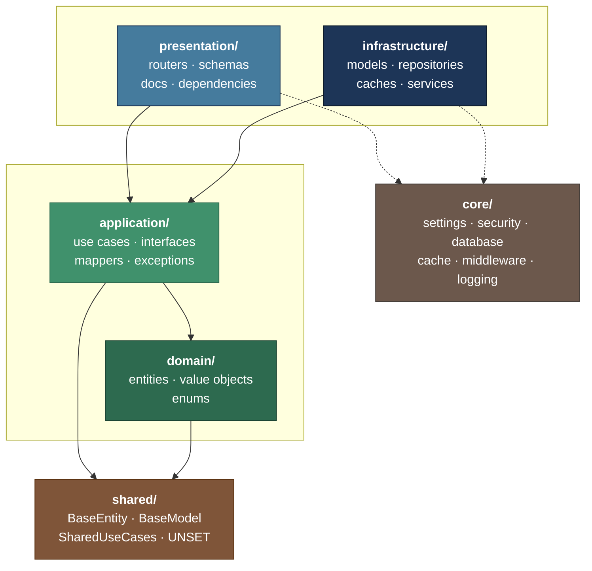
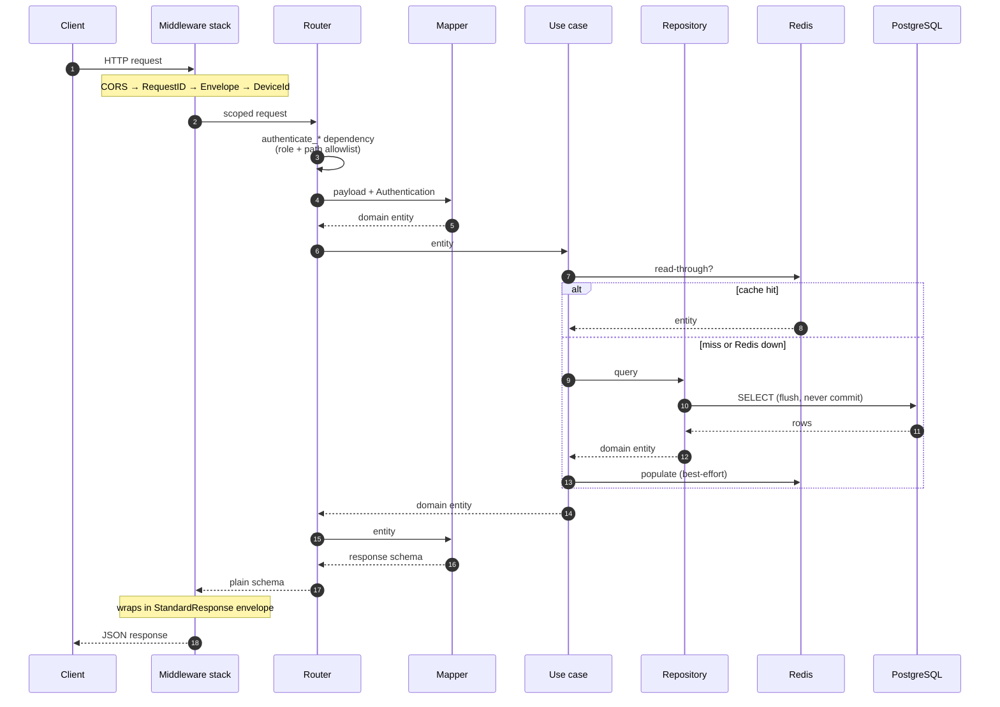

# clean-architecture — FastAPI + Clean Architecture + DDD

**English** · [فارسی](README.fa.md)

[](https://www.python.org/)
[](https://fastapi.tiangolo.com/)
[](https://docs.pydantic.dev/)
[](https://www.sqlalchemy.org/)
[](https://www.postgresql.org/)
[](https://redis.io/)
[](https://www.docker.com/)
[](https://docs.astral.sh/uv/)
[](https://docs.astral.sh/ruff/)
[](LICENSE)

[](https://github.com/Elmino-19/clean-architecture/stargazers)
[](https://github.com/Elmino-19/clean-architecture/network/members)
[](https://github.com/Elmino-19/clean-architecture/issues)
[](https://github.com/Elmino-19/clean-architecture/commits)

A **production-ready base** for quickly starting FastAPI backend projects. Clean
architecture, Domain-Driven Design, and everything already wired — instead of empty
folders and a diagram, you get a working application and only add your own domain code.

This repo exists to **be a base**: clone it, rename it, run three commands, start
coding.

---

## Contents

- [Quick start](#quick-start)
- [Workflow from zero](#workflow-from-zero)
- [Full command reference](#full-command-reference)
- [Scripts](#scripts)
- [opencode tools (skills and agents)](#opencode-tools-skills-and-agents)
- [Architecture](#architecture)
- [Module structure](#module-structure)
- [Error patterns](#error-patterns)
- [Tests](#tests)
- [Configuration (.env)](#configuration-env)
- [Database and migrations](#database-and-migrations)
- [Security](#security)
- [Troubleshooting](#troubleshooting)
- [User guide](docs/user-guide.md)
- [Enhancements](#enhancements)
- [Credits](#credits)
- [Contributing](#contributing)
- [License](#license)

---

## Quick start

### Prerequisites

| Tool | Version | Why |
|---|---|---|
| [Python](https://www.python.org/) | 3.14+ | Pinned in `.python-version` |
| [uv](https://docs.astral.sh/uv/) | latest | Dependency and virtualenv management |
| PostgreSQL | 17 (or Docker) | Source of truth for data |
| Redis | 8 (or Docker) | Cache and sessions |

> Docker is **not required**. If you already have PostgreSQL and Redis running natively
> on your system, that is enough. The Docker commands are just an alternative way to
> bring up the dependencies.

### One command

```bash
uv sync          # install dependencies
make install     # wizard: a few questions, then everything automatic
make dev         # start the server
```

`make install` is an all-in-one installer that asks a few questions, then sets up
everything:

| Step | What it does |
|---|---|
| 1 | **opencode** — validate/create `opencode.jsonc` and the `.opencode/` skills and commands |
| 2 | **`.env`** — write all 83 keys, with generated secrets and values derived from the project name |
| 3 | **Tokens** — generate the JWT key pairs (Ed25519 + X25519) in `secrets/keys/` |
| 4 | **Database** — create role + database, run the initial migration, create the admin user |
| 5 | **Summary** — print the login info and next steps |

The questions are only the things the machine cannot guess; the rest is accepted with Enter:

```text
Project name        [my-project]
Database name       [my-project]
Database user       [my]
Database password   [auto-generate]
Database host       [localhost]
Admin name          [Admin User]
Admin email         [admin@example.com]
Admin password      [auto-generate]
Install opencode skills globally too [y/N]
```

For the question-free mode (CI or scripts):

```bash
make install-yes p="Acme CRM"
# or full control:
uv run python scripts/install.py --yes \
  --project "Acme CRM" --db-name acme_crm --db-user acme \
  --db-password "..." --admin-email admin@acme.io --admin-password "..."
```

> If `sudo` asks for a password to create the role and the terminal is not interactive,
> the script does not stop; it prints ready-to-copy commands and continues with the rest
> of the steps.

After these commands:

| Service | Address |
|---|---|
| API | http://localhost:8000 |
| Swagger UI | http://localhost:8000/docs |
| ReDoc | http://localhost:8000/redoc |
| Health check | http://localhost:8000/health/ |

The admin login is the email/password you set in the wizard (printed in the summary).

### First request

Login is **form-encoded**, not JSON:

```bash
curl -X POST http://localhost:8000/api/v1/authentication/login/ \
  -H "Content-Type: application/x-www-form-urlencoded" \
  -d "username=$SECURITY_ADMIN_EMAIL&password=$SECURITY_ADMIN_PASSWORD" \
  -c cookies.txt

curl http://localhost:8000/api/v1/user/me/ -b cookies.txt
```

---

## Workflow from zero

To start a new project on this base:

```bash
# 1. Clone
git clone https://github.com/Elmino-19/clean-architecture.git my-project && cd my-project

# 2. Rename (optional but recommended)
make rebrand name="Acme CRM" author="Your Name" email="you@acme.io"

# 3. Install dependencies
uv sync

# 4. Full install (wizard)
make install

# 5. Run
make dev
```

To control each step separately:

```bash
make setup       # only .env
make provision   # only database + migrations + admin
make opencode    # only opencode config (global skills install)
```

### After every change

```bash
make test        # run the tests
make lint        # check code quality
make format      # auto-format
```

---

## Full command reference

### Initial setup

| Command | Description |
|---|---|
| `make install` | **All-in-one installer.** A short wizard, then opencode + `.env` + tokens + database + migrations + admin. |
| `make install-yes p="project-name"` | Same as `install` with no questions. Good for CI or scripts. `p` is the project name. |
| `make opencode` | Only opencode config: validates `opencode.jsonc` and installs skills/commands globally into `~/.config/opencode/`. |
| `make setup` | Only builds `.env` (no database). |
| `make setup-yes p="project-name"` | Same as `setup` with no questions. |
| `make env-check` | Only checks whether `.env` is complete and valid. Exit code 1 if any key is empty. |
| `make provision` | PostgreSQL role and database, migrations, admin user and Redis check. Everything is idempotent. |
| `make provision-check` | Only reports what exists and what is missing; builds nothing. |
| `make bootstrap` | `setup` + `provision` back to back (same as `install` minus the opencode step). |
| `make rebrand name="..." author="..." email="..."` | Renames the template to your project. |
| `make doctor` | Full status report: env, service reachability, JWT keys, database, admin. Read-only. |

> **Note:** creating the role/database on Linux needs `sudo -u postgres`. If sudo asks for
> a password and the terminal is not interactive, the script prints ready-to-copy commands
> and continues; run them and hit `make provision` again.

### Run and stop

| Command | Description |
|---|---|
| `make dev` | Local run with `uvicorn --reload` on `APPLICATION_PORT`. |
| `make start` | Bring up the whole stack with Docker Compose and follow the logs. |
| `make start-silent` | Same, without following logs (detached). |
| `make stop` | Stop the Docker stack. |
| `make delete` | Stop and **remove volumes** — data is destroyed. |

### Dependencies (Docker, optional)

| Command | Description |
|---|---|
| `make dependencies-up` | Only PostgreSQL, pgAdmin, Redis and RedisInsight + logs. |
| `make dependencies-up-silent` | Same, detached. |
| `make dependencies-down` | Stop the dependencies. |
| `make logs` | Follow the Compose logs. |
| `make view-processes` | `docker ps -a`. |

### Code quality

| Command | Description |
|---|---|
| `make test` | Run the whole suite with pytest. |
| `make test-watch` | Run tests and re-run automatically on file changes. |
| `make lint` | Check with Ruff. |
| `make format` | Auto-format with Ruff. |

### Database

| Command | Description |
|---|---|
| `make migrate` | Apply migrations up to head. |
| `make migration m="create_x"` | Create a new migration with autogenerate. |

### General

| Command | Description |
|---|---|
| `make help` | List all targets. |

---

## Scripts

All scripts live under `scripts/` and can be run either via `make` or directly with
`uv run python scripts/<name>.py`.

### `install.py` — the all-in-one installer

The heart of the workflow: a wizard with a few questions that runs all steps back to
back. This script drives `opencode_setup`, `setup_env` and `provision` through a single
flow. See [Quick start](#one-command) for the flow details.

```bash
uv run python scripts/install.py                    # interactive wizard
uv run python scripts/install.py --yes --project "Acme CRM"
uv run python scripts/install.py --skip-database    # only .env and tokens
uv run python scripts/install.py --global-assets    # global skills install
```

| Argument | What it does |
|---|---|
| `--project` | Project name |
| `--db-name` / `--db-user` / `--db-password` / `--db-host` / `--db-port` | Database connection details |
| `--admin-name` / `--admin-email` / `--admin-password` | Admin account |
| `--environment` | `development` \| `homolog` \| `production` |
| `--yes` | No questions, all defaults |
| `--global-assets` | Copy skills/commands into `~/.config/opencode/` |
| `--force` | Rotate secrets |
| `--skip-opencode` / `--skip-database` | Skip selected steps |

### `opencode_setup.py` — opencode config

Validates `opencode.jsonc` (and rebuilds it with a backup kept if it is broken) and,
on request, installs the project's skills and commands into `~/.config/opencode/`.

```bash
uv run python scripts/opencode_setup.py            # project check only
uv run python scripts/opencode_setup.py --global   # + global install
```

> The opencode assets live in the project's `.opencode/` folder and opencode reads
> `.opencode/` automatically, so they work project-scoped with no install at all.

### `setup_env.py` — automatic `.env` builder

The problem: `.env.example` has about 83 keys, most of them empty, and filling them by
hand is slow and error-prone. This script fills them in three layers:

| Layer | Example | Behavior |
|---|---|---|
| **Generated** | `REDIS_PASSWORD`, `JWT_HASH_FINGERPRINT`, `SECURITY_ADMIN_PASSWORD` | A secure random value is generated |
| **Derived** | `APPLICATION_TABLE_PREFIX`, `POSTGRESQL_DATABASE`, `REDIS_KEY_PREFIX`, `LOGS_NAME` | Built from the project name (slug) |
| **Preserved** | Any key that already has a value | Left untouched |

Important behaviors:

- **Idempotent:** re-running does not rotate the live database password.
- **Free-port detection:** if 8000/5432/6379 is taken, the next free port is picked
  automatically and `APPLICATION_URL`/`JWT_ISSUER` are synced with it.
- **`--force`:** forcibly rotate secrets.

```bash
# interactive
uv run python scripts/setup_env.py

# no questions
uv run python scripts/setup_env.py --yes --project "Acme CRM" --admin-email a@b.io

# check only
uv run python scripts/setup_env.py --check
```

| Argument | What it does |
|---|---|
| `--project` | Project name (slug) |
| `--title` | Override `APPLICATION_TITLE` |
| `--host` | Host used to build URLs (default `localhost`) |
| `--environment` | `development` \| `homolog` \| `production` |
| `--cookie-samesite` | `lax` \| `strict` \| `none` |
| `--admin-email` | Admin email (no prompt) |
| `--admin-password` | Admin password (no prompt) |
| `--contact-phone` | OpenAPI contact phone |
| `--yes` | Never prompt |
| `--force` | Rotate secrets even when they already have values |
| `--check` | Only report missing keys |

### `provision.py` — database, admin and tokens

Runs in dependency order and every step is idempotent:

```
role + database  →  migrations  →  admin user
redis check
```

- **PostgreSQL:** if the role or database is missing, it creates them via `sudo -u postgres psql`.
  On Linux this path is usually required because `pg_hba.conf` sets `peer` auth for the
  superuser and rejects TCP password login. If sudo needs a password and the terminal
  is not interactive, ready-to-run commands are printed.
- **Redis:** checks the connection with the `.env` password (never-fail; warning only).
- **Migrations:** `alembic upgrade head`.
- **Admin:** creates a user with the `ADMIN` role and an Argon2-hashed password.

```bash
uv run python scripts/provision.py                 # everything
uv run python scripts/provision.py --check         # status only
uv run python scripts/provision.py --skip-redis    # skip Redis
uv run python scripts/provision.py --skip-migrations
uv run python scripts/provision.py --skip-admin
uv run python scripts/provision.py --admin-name "Sara Ahmadi"
```

### `doctor.py` — health check (read-only)

Builds nothing and changes nothing. It checks:

- `.env` is complete and valid
- PostgreSQL and Redis are reachable
- JWT keys exist
- role/database have been created
- the admin user has been seeded

```bash
make doctor
# or
uv run python scripts/doctor.py
```

Exit code 1 if any check fails — CI-friendly.

### `rebrand.py` — rename the template

The template name is hardcoded in four flavors: the dashed slug (Docker), the underscored
slug (table names), the Title Case display name, and the author contact details. This
script replaces all four, plus the package name in `pyproject.toml`.

```bash
# show changes without writing
uv run python scripts/rebrand.py "Acme CRM" --dry-run

# apply
uv run python scripts/rebrand.py "Acme CRM" \
  --author "Your Name" --email "you@acme.io" --url "https://acme.io"

# also rewrite docs (README and markdown)
uv run python scripts/rebrand.py "Acme CRM" --docs
```

| Argument | What it does |
|---|---|
| `--author` / `--email` / `--url` | Contact details |
| `--docs` | Also rewrite README and markdown files |
| `--dry-run` | Show only, do not write |

> By default `README.md` is left untouched because it holds the architecture docs you
> want to keep. Rewrite those too with `--docs`.

### `create_module.py` — module scaffolding

```bash
uv run python scripts/create_module.py
```

Asks for the module name and builds the full four-layer structure (the needed files +
the test folder).

### Other scripts

| Script | What it does |
|---|---|
| `generate_secret.py` | Prints a 32-byte hex secret |
| `generate_fernet.py` | Prints a Fernet key |
| `directory_tree.py` | Writes the project tree into `scripts/directory_tree.txt` |
| `websocket_test.html` | Browser WebSocket client (served on `/devtools/` in `development`) |
| `asyncapi.yaml` | AsyncAPI spec for the WebSocket channel |

---

## opencode tools (skills and agents)

The project ships a skill and agent bundle that lives in `.opencode/` and opencode reads
automatically. To install globally for all projects:

```bash
make opencode      # copy into ~/.config/opencode/
```

### Skills

| Skill | What it does |
|---|---|
| `software-design-document` | Writing the software design document (template, architecture rules, contracts) |
| `backend-development` | Implementing code per the architecture: per-layer recipes, error patterns, transactions, naming |

Each skill is a short `SKILL.md` with the details next to it in `references/`
(progressive disclosure).

### Agents

| Agent | Role | Access |
|---|---|---|
| `sdd-writer` | Writes the software design document (`docs/sdd.md`), no code | Free edit |
| `code-explorer` | Codebase analysis and exploration: architecture, flow, blast radius | Read-only |
| `backend-developer` | Backend implementation (module, use case, repository, router) | Free edit |
| `code-auditor` | Reviews code against the rules/skills; reports deviations | Read-only |

### Commands

Each command invokes one of the agents in a **specific scope**. The text after the
command name reaches the agent as its argument (if empty, it asks).

| Family | Agent | File | Module | Layer (all modules) | All modules |
|---|---|---|---|---|---|
| `audit-*` | code-auditor | `/audit-file <path>` | `/audit-module <module>` | `/audit-layer <layer>` | `/audit-all` |
| `explore-*` | code-explorer | `/explore-file <path>` | `/explore-module <module>` | `/explore-layer <layer>` | `/explore-all` |
| `develop-*` | backend-developer | `/develop-file <path>` | `/develop-module <module>` | `/develop-layer <layer>` | `/develop-all` |
| `design-*` | sdd-writer | `/design-file <part>` | `/design-module <module>` | `/design-layer <concern>` | `/design-all` |

- `<layer>` is one of `domain` \| `application` \| `infrastructure` \| `presentation`.
- `audit-*` and `explore-*` run as **subtasks**: they execute in an isolated session and
  the summary comes back, so the main context stays clean.
- `develop-*` and `design-*` run in the same session to stay interactive.

After changing this bundle, **quit and restart** opencode so it loads.

---

## Architecture

Every module is split into four layers. Dependencies point **inward only** — the domain
knows nothing outside itself.



| Layer | Folder | Contents | May import |
|---|---|---|---|
| **Domain** | `domain/` | `entities.py`, `value_objects.py`, `enums.py` | Only `shared`. **No** FastAPI, SQLAlchemy, Pydantic |
| **Application** | `application/` | `use_cases.py`, `interfaces.py`, `mappers.py`, `exceptions.py`, `utils.py` | `domain`, `shared` |
| **Infrastructure** | `infrastructure/` | `models.py`, `repositories.py`, `caches.py`, `services.py` | `domain`, `application`, `core` |
| **Presentation** | `presentation/` | `routers.py`, `schemas.py`, `docs.py`, `dependencies.py` | Everything below it |

The application layer depends on `typing.Protocol` contracts, never on concrete classes.
That is what makes a use case testable with an in-memory fake and lets you swap
PostgreSQL without touching business logic.

### Request lifecycle



Handlers never build the response envelope — `ResponseFormattingMiddleware` does that.
Handlers never hold business logic — the use case does that. Every handler body is
exactly `payload → mapper → use case → mapper → return`.

### Modules

```text
app/modules/
├── shared/           base types — no routes
├── authentication/   login, refresh, logout; nested JWT issuance
├── user/             accounts and roles
├── key/              API keys — the most complete module (reference)
├── knowledge/        CRUD + broadcast notification (reference)
├── notification/     per-user and role-based fan-out
├── websocket/        realtime delivery
├── health/           liveness and Alembic version
└── example/          minimal reference module, no persistence
```

> When a pattern is ambiguous, read **`key`**. It is the only module that exercises
> every layer: tombstone cache, a service, full CRUD, and transient secret handling.

---

## Module structure

```text
app/modules/{module}/
├── domain/
│   ├── entities.py          dataclasses extending BaseEntity; validation in __post_init__
│   ├── value_objects.py     plain classes: _normalize → _validate → __str__ → __eq__
│   └── enums.py             module enums, always (str, Enum)
├── application/
│   ├── interfaces.py        Protocol contracts: I{Entity}Repository / Cache / Service
│   ├── use_cases.py         one {Module}UseCases class; business rules live here
│   ├── mappers.py           ENTITY/DTOS · ENTITY/MODELS · ENTITY/CACHE
│   ├── exceptions.py        generic {Module}Exception + one per business rule
│   └── utils.py             module-local helpers
├── infrastructure/
│   ├── models.py            SQLAlchemy models extending BaseModel
│   ├── repositories.py      Postgres{Entity}Repository — flush(), never commit()
│   ├── caches.py            Redis{Entity}Cache — namespaced, tombstone, never-raise
│   └── services.py          external or stateful systems behind a Protocol
└── presentation/
    ├── routers.py           handlers: payload → mapper → use case → mapper → return
    ├── schemas.py           Pydantic v2 with full Field and ConfigDict
    ├── docs.py              router_docs + one {action}_docs per endpoint
    └── dependencies.py      Depends factories, returning the Protocol type
```

Empty files are normal. A module keeps the full skeleton even when a file is unused —
an empty `caches.py` means "this module has no cache", not "someone forgot a file".

`scripts/create_module.py` builds exactly this tree.

### Naming rules

| Concept | Pattern | Example |
|---|---|---|
| Module | singular snake_case | `knowledge` |
| Entity | PascalCase, no suffix | `Knowledge` |
| Enum | PascalCase + Status/Type/Role | `Role` |
| Domain Error | PascalCase + Error | `KnowledgeNotFoundError` |
| Interface | `I` + PascalCase + Repository/Service | `IKnowledgeRepository` |
| Use Case | `{Module}UseCases` | `KnowledgeUseCases` |
| Model | PascalCase + Model | `KnowledgeModel` |
| Repository | `Postgres` + PascalCase + Repository | `PostgresKnowledgeRepository` |
| Cache | `Redis` + PascalCase + Cache | `RedisKnowledgeCache` |
| Router | `router` variable | `router = APIRouter(**router_docs)` |
| Table | `{prefix}_{plural_snake}` | `acme_crm_knowledges` |
| Constraint | `uq_/ix_/ck_/fk_` + table name | `uq_knowledges_name` |

---

## Error patterns

Three shapes, one per layer kind. Getting this wrong is the most expensive mistake in
the codebase.

**3-branch** — use cases and router handlers:

```python
except StandardException:
    raise
except DomainError as e:
    raise DomainException(e)
except Exception as e:
    logger.opt(exception=e).error("An error occurred in the create endpoint.")
    raise KnowledgeException()
```

**2-branch** — repositories and services. No `DomainError` branch: these layers never
evaluate domain rules.

```python
except StandardException:
    raise
except Exception as e:
    logger.opt(exception=e).error("An error occurred in the create repository.")
    raise KnowledgeException()
```

**Never-raise** — caches. Every method catches, logs and returns `None`.

```python
except Exception as e:
    logger.opt(exception=e).error(
        "An error occurred in the get cache. Falling back to the database."
    )
    return None
```

> [!WARNING]
> `except StandardException` **must come first**. `StandardException` inherits from
> `HTTPException`, so any other order swallows every deliberate 404 and 409 into a 500.

A cache failure degrades to the database and must never fail the request — that is why
the cache shape has no re-raise branch.

---

## Tests

The policy is **unit-first**: drive use cases with in-memory fakes of their Protocols,
construct entities directly, and touch no real database, Redis or network.

```bash
make test          # run the whole suite
make test-watch    # auto re-run on file changes
```

Structure:

```text
test/
├── fakes.py                         in-memory fakes for all Ports
├── core/
└── modules/
    └── knowledge/
        ├── test_domain.py           pure domain-layer tests
        └── test_use_cases.py        use-case tests with fakes
```

### Writing tests for a new module

1. If your module brings a new Port, add its fake to `test/fakes.py`.
2. Domain test: build the entity/value object directly and assert the rules.
3. Use-case test: inject the fake and assert behavior and business rules.

```python
# sample use-case test with a fake
async def test_rejects_duplicate_name(use_cases, manager):
    await use_cases.create(Knowledge(name="Duplicate", created_by=manager))
    with pytest.raises(KnowledgeNameAlreadyExistsException):
        await use_cases.create(Knowledge(name="Duplicate", created_by=manager))
```

`pytest` and `pytest-asyncio` are preconfigured (`asyncio_mode = "auto"`).

---

## Configuration (.env)

Every setting is a typed field on `Settings` in `app/core/settings.py`, read from
`.env` by pydantic-settings. Always use the `settings` singleton — never `os.environ`.

> [!IMPORTANT]
> Most fields are **required**. An empty value raises a `ValidationError` naming the key
> at startup. This is deliberate: a silent default that differs between environments is
> far harder to debug than a startup failure.

### Key groups

| Group | Count | Sample |
|---|---|---|
| APPLICATION | 13 | `APPLICATION_TITLE`, `APPLICATION_PORT`, `APPLICATION_TABLE_PREFIX` |
| API KEY | 3 | `API_KEY_PREFIX`, `API_KEY_HASH_FINGERPRINT` |
| AUTH | 5 | Scheme names and descriptions |
| COOKIES | 9 | `COOKIES_ACCESS_TOKEN_KEY`, `COOKIES_SAME_SITE` |
| JWT | 13 | `JWT_ISSUER`, `JWT_ACCESS_TOKEN_EXPIRE_MINUTES`, key paths |
| LOGS | 5 | `LOGS_LEVEL`, `LOGS_NAME` |
| POSTGRESQL | 5 | `POSTGRESQL_DATABASE`, `POSTGRESQL_HOST` |
| PGADMIN | 3 | pgAdmin login (Compose only) |
| REDIS | 18 | `REDIS_PASSWORD`, `REDIS_DEFAULT_TTL_SECONDS` |
| REDISINSIGHT | 2 | Compose only |
| NGROK | 1 | Optional tunnel token in `development` |
| SECURITY | 6 | `SECURITY_ALLOW_ORIGINS`, `SECURITY_ADMIN_EMAIL` |

### Computed values

These are derived from the keys above and must not be set directly:

| Property | Derived from |
|---|---|
| `POSTGRESQL_DATABASE_URL` / `_ASYNC_DATABASE_URL` | The `POSTGRESQL_*` group |
| `REDIS_URL` | The `REDIS_*` connection group |
| `REDIS_NAMESPACE` | `REDIS_KEY_PREFIX` + `REDIS_CACHE_VERSION` |
| `JWT_SIGNING_*_KEY`, `JWT_ENCRYPTION_*_KEY` | The PEM files on disk |
| `SECURITY_*_ALLOWED_PATHS` | The per-tier path rules |
| `COOKIES_ACCESS_TOKEN_MAX_AGE` | `JWT_ACCESS_TOKEN_EXPIRE_MINUTES × 60` |

> Set the JWT expiry, not the cookie age — the cookie age follows.

### Environments

`APPLICATION_ENVIRONMENT`: one of `development` | `homolog` | `production`.

- In `development`: docs (`/docs`, `/redoc`) are on, dev tools mount on `/devtools/`,
  and ngrok runs.
- In `production`: docs off, ngrok disabled.

---

## Database and migrations

### Tables

Tables carry the `APPLICATION_TABLE_PREFIX` prefix, so with the `acme_crm` prefix the
users table becomes `acme_crm_users`. Migrations read the same setting, so table names
always match between models, migrations and the database.

### Conventions

| Concept | Rule | Example |
|---|---|---|
| Table name | `{prefix}_{plural_snake}` | `acme_crm_keys` |
| Enum type | `{snake}_enum` | `role_enum` |
| Unique | `uq_{plural}_{cols}` | `uq_keys_hashed_key` |
| Index | `ix_{plural}_{cols}` | `ix_keys_prefix` |
| Check | `ck_{plural}_{rule}` | `ck_keys_single_owner` |
| Soft delete | `is_active = false` | Never a physical `DELETE` |

### Migrations

```bash
make migrate                          # apply up to head
make migration m="create_my_entity"   # create a new migration
```

> [!IMPORTANT]
> A new model must be imported in `migrations/env.py` and added to the `_ = [...]` list.
> Autogenerate only sees registered models — worse, it emits a `drop_table` for a live
> table whose model it cannot see.

The app runs `alembic upgrade head` at startup, so a fresh stack migrates itself.

---

## Security

### Login and sessions

- Nested JWT: **JWS** signature with Ed25519, wrapped in **JWE** with ECDH-ES + A256GCM.
- Tokens come in **HTTP-only** cookies, not the `Authorization` header.
- An HMAC-SHA256 fingerprint of each token's `jti` is stored in the database (not the
  token itself), which makes tokens revocable.
- Password hashing with **Argon2id**.

### Roles and the two gates

| Tier | Setting | Reaches |
|---|---|---|
| Public | `SECURITY_NO_AUTH_PATHS` | Everyone, even anonymous |
| User | `SECURITY_USER_ALLOWED_PATHS` | Public + user |
| Manager | `SECURITY_MANAGER_ALLOWED_PATHS` | User + manager |
| Admin | `SECURITY_ADMIN_ALLOWED_PATHS` | Manager + admin |
| API key | `SECURITY_API_KEY_ALLOWED_PATHS` | Independent — currently empty |

Each path is declared **once**, in the lowest tier that should reach it. Both the
trailing-slash and non-slash forms are required:

```python
(_path_rule("/api/v1/key/", "POST"),)
(_path_rule("/api/v1/key", "POST"),)
```

> [!WARNING]
> Forgetting the second form is the most common cause of "works in Swagger, 403 from
> the client".

### API keys

Full lifecycle: create, list, rotate, revoke. The raw key is returned **exactly once**
and never stored; only `hashed_key`, `prefix` and `last_four` remain.

---

## Troubleshooting

### `make env-check` says a key is empty

```bash
make setup        # auto-fill
```

### `make provision` says `sudo needs a password`

On Linux, creating the role/database needs the superuser. Run the printed commands in
an interactive terminal, then:

```bash
make provision
```

If you have Docker and prefer it:

```bash
make dependencies-up-silent
make provision
```

### `Settings` raises `ValidationError` at startup

The named key is empty in `.env`. Run `make doctor` to see the full status.

### "Works in Swagger but 403 from the client"

The non-trailing-slash form of the path is not registered in that tier. Add both forms.

### `greenlet` is missing

`SQLAlchemy[asyncio]` does not work without greenlet. This dependency is in
`pyproject.toml`; if it was removed by hand:

```bash
uv sync
```

### Cache serves stale data

Bump `REDIS_CACHE_VERSION`. The previous generation expires on its own via TTL — this
is the correct response to a payload-format change, not flushing the cache.

---

## Enhancements

This repo is built on a ready-made FastAPI + Clean Architecture + DDD template, with
the following added or improved on top:

- **Automatic setup:** the `setup_env`, `provision`, `doctor`, `rebrand` and
  `create_module` scripts plus the all-in-one `make install` wizard — full `.env`
  writing, JWT key-pair generation, role and database creation, migration runs and
  admin-user seeding.
- **opencode toolkit:** two skills (`backend-development`, `software-design-document`),
  four agents and sixteen commands under `.opencode/` for development, architecture
  review and design-doc generation.
- **Installable CLI (`fastddd`):** the scripts and opencode assets packaged into a
  PyPI-ready wheel; install with `uv tool install` and run everything with one command
  (`fastddd setup|db|doctor|opencode|new-module|...`).
- **Code quality:** a strict Ruff configuration (`E,W,F,I,UP,B,C4,SIM,RET,RUF`),
  auto-formatting and fixed findings (including `raise ... from`, redundant assignments
  and import order).
- **Tests:** `pytest` + `pytest-asyncio` configuration and domain / use-case unit tests
  with fakes — no database or Redis needed.

---

## Credits

This project is built on the work of **Bruno Tanabe** ([@BrunoTanabe](https://github.com/BrunoTanabe)).
The clean architecture, layering and initial patterns are his; thank you.

---

## Contributing

1. Branch off main.
2. Follow the conventions — the [Architecture](#architecture) section documents every
   layer pattern, the three error shapes and the naming rules.
3. Before committing: `make lint && make format && make test`.
4. Use [Conventional Commits](https://www.conventionalcommits.org/):
   `feat(knowledge): add export endpoint`.
5. Open a pull request and explain what changed and why.

New here? Read `app/modules/key/` end to end. It exercises every layer and every pattern
in a single module.

---

## License

Released under the [MIT License](LICENSE).
